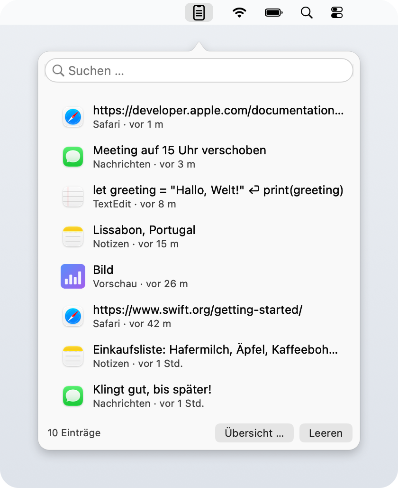
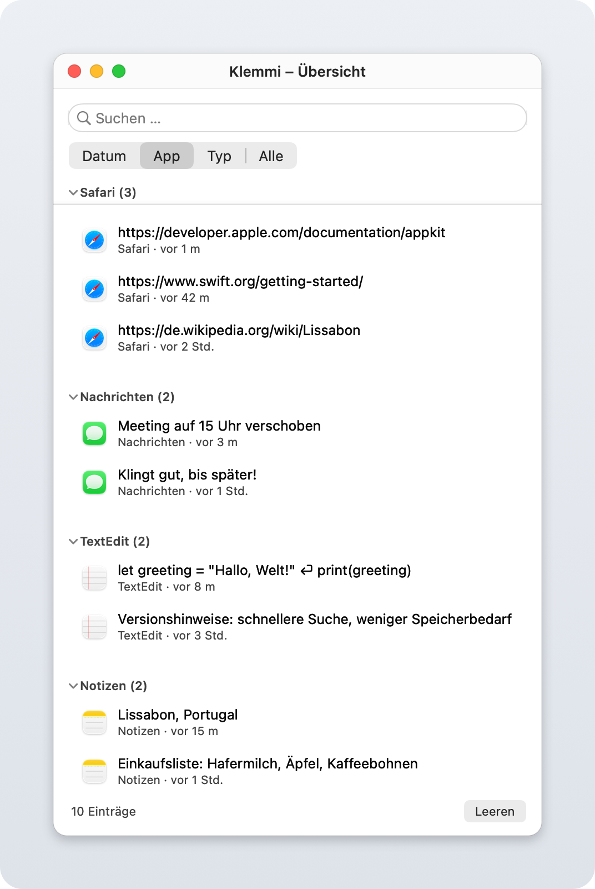
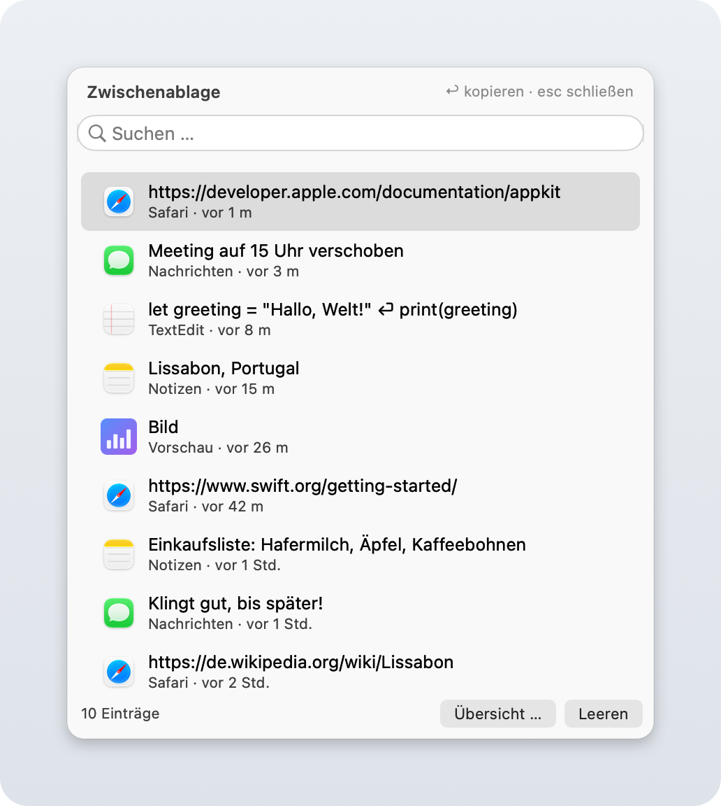

# Klemmi

Klemmi ist eine kleine native macOS-App, die einen durchsuchbaren Verlauf der Zwischenablage führt – Text und Bilder, jeweils mit Zeitstempel und der App, aus der der Inhalt kopiert wurde. Ersatz für Tools wie Pasta.

  [](LICENSE) [](https://github.com/search?q=topic%3Ai-love-macos-but-i-miss-windows-features+user%3Aleonatwork&type=repositories)

Voraussetzung: **Apple Silicon, macOS 13+**.

*🇬🇧 [English version](README.md) — die englische Fassung ist maßgeblich und wird zuerst aktualisiert.*

## Teil des Pakets

Klemmi ist eines von vier Tools im Paket **[I love macOS, but I miss some Windows features](https://github.com/search?q=topic%3Ai-love-macos-but-i-miss-windows-features+user%3Aleonatwork&type=repositories)**:

| Tool | Was es macht | Download |
| --- | --- | --- |
| [Tappi](https://github.com/leonatwork/Tappi) | Alt+Tab zwischen Fenstern statt Apps | [Neueste Version](https://github.com/leonatwork/Tappi/releases/latest) |
| **[Klemmi](https://github.com/leonatwork/Klemmi)** (dieses Tool) | Zwischenablage-Verlauf wie Win+V, mit Quell-App | [Neueste Version](https://github.com/leonatwork/Klemmi/releases/latest) |
| [Snapline](https://github.com/leonatwork/snapline) | Snap Layouts, Aero Snap und Snap Assist aus Windows 11 | [Neueste Version](https://github.com/leonatwork/snapline/releases/latest) |
| [Snapboard](https://github.com/leonatwork/snapboard) | Screenshots wie mit dem Snipping Tool, direkt in die Zwischenablage | [Neueste Version](https://github.com/leonatwork/snapboard/releases/latest) |

Vermisst du auf dem Mac mehr als eine dieser Funktionen? Lade gleich alle vier herunter – sie sind klein und ergänzen sich.

## Screenshots

<div align="center">
  
  <br />
  <em>Menüleisten-Popover — mit Suche; jeder Eintrag zeigt, aus welcher App er stammt und wann</em>
  <br /><br />
  
  <br />
  <em>Übersichtsfenster, gruppiert nach Quell-App (alternativ nach Datum oder Typ)</em>
</div>

## Funktionen

- **Frei belegbares globales Kürzel, Standard ⌃⌥⌘V**: öffnet ein schwebendes Overlay mit dem Verlauf auf dem Bildschirm, auf dem die Maus ist – ohne der App, in der man gerade arbeitet, den Fokus zu nehmen. Tippen filtert, ↑/↓ wählt, ↩ legt den Eintrag in die Zwischenablage und schließt das Overlay, esc schließt. Braucht keine Bedienungshilfen-Berechtigung. Über **Kürzel ändern…** im Rechtsklick-Menü nimmst du ein Kürzel mit mindestens ⌘, ⌃ oder ⌥ auf; Esc bricht ab, ⌫ setzt auf den Standard zurück. Das Kürzel bleibt nach Neustarts sowie beim Aus- und Einschalten erhalten. Das Menü zeigt die Taste aus der aktuellen Tastaturbelegung und setzt das Häkchen nur bei aktiver Registrierung. Schlägt die Registrierung eines neuen Kürzels fehl, erscheint eine Fehlermeldung und das bisherige bleibt aktiv. Registrierungsfehler beim Start sind im Menü markiert. Der neue Standard gilt für alle ohne gespeichertes Kürzel.

  <div align="center">
    
    <br />
    <em>Das Overlay — der neueste Eintrag ist vorausgewählt, ↩ kopiert ihn</em>
  </div>

- **Direkt einfügen** (optional, standardmäßig aus): Ist **Direkt einfügen** im Rechtsklick-Menü eingeschaltet, sendet ↩ im Overlay zusätzlich ⌘V an die App, in der man gerade gearbeitet hat – wie bei Win+V. ⌥↩ macht für diesen einen Eintrag das Gegenteil der Einstellung; Mausklicks kopieren immer nur. Das ist die einzige Funktion, die die Berechtigung für **Bedienungshilfen** braucht: Klemmi erklärt vorher, warum, bevor macOS fragt, und der Hinweis im Overlay zeigt, ob ↩ einfügt oder kopiert. Fehlt das Recht oder wird es entzogen, kopiert ↩ wieder nur, und der Menüpunkt verweist auf die Systemeinstellungen. Die Taste „V“ wird in der aktiven Tastaturbelegung gesucht, funktioniert also auch mit Dvorak und anderen Belegungen.
- **Menüleisten-Symbol**: Klick öffnet ein kompaktes Popover mit dem Verlauf, Rechtsklick ein Menü (Übersicht öffnen, Dock-Symbol ein-/ausblenden, sensible Inhalte ignorieren, Kürzel ein-/ausschalten oder ändern, Direkt einfügen, Verlauf leeren, weitere Apps aus dem Paket, Beenden).
- **Bei Anmeldung starten**: Klemmi meldet sich beim ersten Start einmalig selbst an,
  auch beim ersten Start nach dem Update auf diese Funktion. Danach steuert **Bei Anmeldung
  starten** im Rechtsklick-Menü die Anmeldung; nach dem Abschalten oder einem fehlgeschlagenen
  Erstversuch erfolgt keine erneute automatische Anmeldung. Das Häkchen zeigt den aktuellen
  macOS-Status. Ist eine Freigabe nötig, öffnet der entsprechend markierte Menüpunkt die
  Anmeldeobjekte in den Systemeinstellungen. Beim Anmeldestart öffnet sich kein Fenster.
- **Übersichtsfenster**: größere Fensteransicht mit Gruppierung nach **Datum** (Heute/Gestern/Diese Woche/älter), **App** oder **Typ** (Text/Bilder) – erreichbar über „Übersicht …“ im Popover oder Rechtsklick-Menü.
- **Erfasst Text und Bilder** aus der Zwischenablage – jeder Eintrag zeigt, aus welcher App er stammt (Name + Icon) sowie eine relative Zeitangabe.
- **Suche** über Text und Quell-App, sowohl im Popover als auch im Übersichtsfenster.
- **Zurück in die Zwischenablage**: Doppelklick auf einen Eintrag (bzw. Rechtsklick → „In Zwischenablage kopieren“ im Übersichtsfenster) kopiert ihn wieder in die Zwischenablage (Einfügen erfolgt manuell per ⌘V, sofern nicht **Direkt einfügen** für das Overlay eingeschaltet ist).
- **Persistenz**: Verlauf liegt unter `~/Library/Application Support/Klemmi` (Bilder als PNG, Metadaten als JSON) und übersteht einen Neustart der App.
- **Begrenzung**: Standardmäßig die letzten 200 Einträge, ältere fallen automatisch raus (samt zugehöriger Bilddatei).
- **Respektiert Passwort-Manager**: Inhalte, die per `org.nspasteboard.ConcealedType`/`TransientType`-Konvention als sensibel markiert sind (z. B. aus 1Password), werden standardmäßig nicht gespeichert (abschaltbar).
- **Spricht deine Sprache**: Die Oberfläche gibt es auf Englisch, Deutsch, Französisch, Spanisch, Italienisch, Portugiesisch (Brasilien), Niederländisch, Japanisch, vereinfachtem Chinesisch und Koreanisch; sie folgt der Spracheinstellung von macOS.

### Bekannte Grenzen (v1)

- Die Quell-App wird über die zum Zeitpunkt des Kopierens vorderste App ermittelt (macOS liefert keine direkte Quellangabe über die Zwischenablage) – in der Regel zuverlässig, aber kein Systemgarantie.
- Automatisches Einfügen gibt es nur per ↩ im Overlay und nur mit Bedienungshilfen-Berechtigung. Aus dem Popover und dem Übersichtsfenster landet ein Eintrag nur in der Zwischenablage, eingefügt wird klassisch per ⌘V.

## Installation

1. `Klemmi-<version>.zip` aus der
   [neuesten Version](https://github.com/leonatwork/Klemmi/releases/latest) herunterladen.
2. Entpacken und `Klemmi.app` in den Ordner `Programme` (`/Applications`) bewegen.
3. Beim ersten Start per **Rechtsklick ▸ Öffnen** starten. Die Builds sind signiert, aber
   nicht notarisiert, daher blockiert Gatekeeper einen einfachen Doppelklick beim ersten
   Start. Ab macOS 15 nach dem ersten Versuch **Systemeinstellungen ▸ Datenschutz &
   Sicherheit** öffnen und **Dennoch öffnen** klicken. Meldet macOS, die App sei beschädigt, oder alternativ zu den
   Schritten oben das Quarantäne-Attribut im Terminal entfernen:

   ```bash
   xattr -dr com.apple.quarantine /Applications/Klemmi.app
   ```

Klemmi braucht standardmäßig keine besonderen Berechtigungen – das Lesen der Zwischenablage
ist unter macOS nicht hinter einer Datenschutzabfrage verborgen. Nur die optionale Einstellung
**Direkt einfügen** fragt nach der Berechtigung für Bedienungshilfen, weil das Senden von ⌘V an
eine andere App sie erfordert. Sie lässt sich jederzeit unter **Systemeinstellungen ▸
Datenschutz & Sicherheit ▸ Bedienungshilfen** entziehen; Klemmi kopiert dann wieder nur.

## Aus dem Quellcode bauen

Voraussetzung sind die Xcode Command Line Tools – weitere Abhängigkeiten gibt es nicht.

```bash
xcode-select --install
git clone https://github.com/leonatwork/Klemmi.git
cd Klemmi
./build.sh
```

Das Skript kompiliert die Quellen, kopiert die Übersetzungen, erzeugt das App-Symbol und legt `Klemmi.app` in `dist/` ab; `./build.sh --install` kopiert sie zusätzlich nach `/Applications` und startet sie. Nach Änderungen an Übersetzungen `scripts/check-localizations.sh` ausführen.

## Aufbau

| Datei | Inhalt |
| --- | --- |
| `Sources/main.swift` | App-Delegate, Einstiegspunkt |
| `Sources/StatusItem.swift` | Menüleisten-Symbol, Popover, Kontextmenü |
| `Sources/Overlay.swift` | Schwebendes Overlay, geöffnet per globalem Kürzel |
| `Sources/HotKey.swift` | Frei belegbares globales Kürzel über Carbon; Anzeige aus der Tastaturbelegung |
| `Sources/HotKeyPolicy.swift` | Validierung, Speicherung, Anzeige und transaktionale Registrierungsentscheidungen |
| `Sources/HotKeyRecorder.swift` | Modaler Recorder aus dem Rechtsklick-Menü |
| `Sources/DirectPastePolicy.swift` | Reine Entscheidungen für „Direkt einfügen“ (Einstellung, Recht, ⌥, Tastatur/Maus) |
| `Sources/DirectPaste.swift` | Bedienungshilfen-Recht, Erklärdialog, sendet ⌘V per CGEvent |
| `Sources/HistoryList.swift` | Tabellenansicht des Verlaufs samt Suche (Popover) |
| `Sources/MainWindow.swift` | Übersichtsfenster mit Gruppierung nach Datum/App/Typ |
| `Sources/ClipboardMonitor.swift` | Pollt die Zwischenablage, erkennt Quell-App |
| `Sources/HistoryStore.swift` | Verlauf im Speicher + Persistenz auf Platte |
| `Sources/HistoryItem.swift` | Datenmodell eines Eintrags |
| `Sources/Clipboard.swift` | Schreibt einen Eintrag zurück in die Zwischenablage |
| `Sources/Support.swift` | Einstellungen (UserDefaults) |
| `Sources/Localization.swift` | `L10n`-Hilfe rund um `NSLocalizedString` |
| `Resources/<lang>.lproj/` | Übersetzungen (`Localizable.strings`, Mehrzahl in `Localizable.stringsdict`) |
| `scripts/check-localizations.sh` | Prüft, dass jede Sprache jeden Schlüssel hat und alle Dateien gültig sind |
| `icon.swift` | Erzeugt das App-Symbol als `.icns` |

## Open Source & Premium

Klemmi ist und bleibt Open Source unter der MIT-Lizenz. Alles in diesem Repository darf
weiterhin frei genutzt, verändert und weitergegeben werden.

Geplant sind zwei Wege, das Projekt zu unterstützen:

- **Sponsoring**: freiwillige Unterstützung der Weiterentwicklung. Der Link folgt hier,
  sobald er eingerichtet ist.
- **Premium-Erweiterungen**: optionale Zusatzfunktionen als separates, kostenpflichtiges
  Paket. Sie bauen auf dem freien Kern auf und nehmen ihm nie Funktionen weg.

## Lizenz

[MIT](LICENSE) — freie Nutzung, Änderung und Weitergabe, ohne Gewährleistung.
