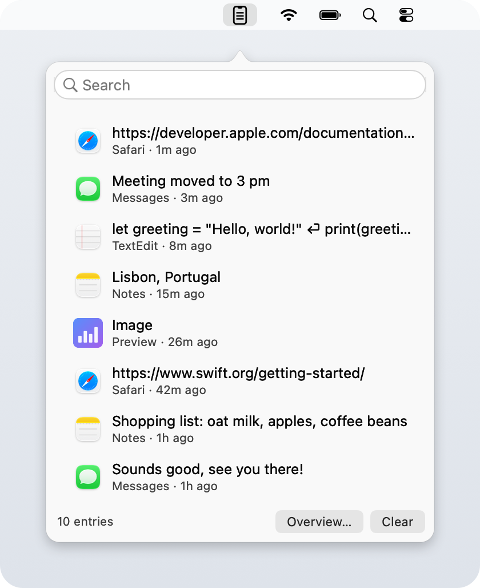
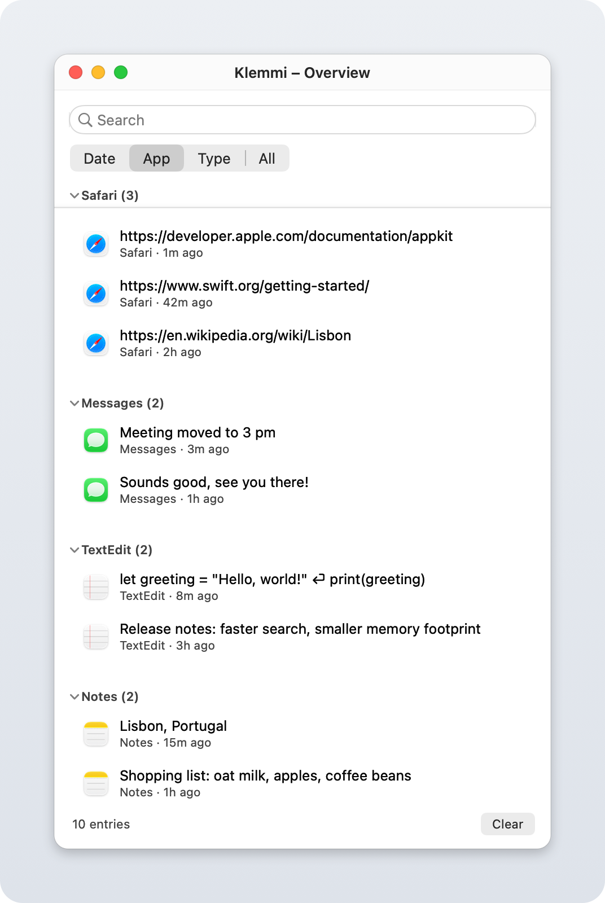

# Klemmi

Klemmi is a small native macOS app that keeps a searchable clipboard history — text and
images, each with a timestamp and the app the content was copied from. It brings the
`Win`+`V` clipboard history from Windows to macOS.

  [](LICENSE) [](https://github.com/search?q=topic%3Ai-love-macos-but-i-miss-windows-features+user%3Aleonatwork&type=repositories)

*🇩🇪 [Deutsche Version](README.de.md)*

## Part of the package

Klemmi is one of four tools in the package **[I love macOS, but I miss some Windows features](https://github.com/search?q=topic%3Ai-love-macos-but-i-miss-windows-features+user%3Aleonatwork&type=repositories)**:

| Tool | What it does | Download |
| --- | --- | --- |
| [Tappi](https://github.com/leonatwork/Tappi) | Alt+Tab between windows, not apps | [Latest release](https://github.com/leonatwork/Tappi/releases/latest) |
| **[Klemmi](https://github.com/leonatwork/Klemmi)** (this tool) | Clipboard history like Win+V, with the app each entry came from | [Latest release](https://github.com/leonatwork/Klemmi/releases/latest) |
| [Snapline](https://github.com/leonatwork/snapline) | Windows 11 Snap Layouts, Aero Snap and Snap Assist | [Latest release](https://github.com/leonatwork/snapline/releases/latest) |
| [Snapboard](https://github.com/leonatwork/snapboard) | Snipping-Tool-style screenshots straight to the clipboard | [Latest release](https://github.com/leonatwork/snapboard/releases/latest) |

Miss more than one of these on your Mac? Grab all four — they are small and work well together.

## Screenshots

<div align="center">
  
  <br />
  <em>Menu bar popover — every entry shows the app it was copied from</em>
  <br /><br />
  
  <br />
  <em>Overview window, grouped by source app</em>
</div>

## Features

- **Global shortcut** <kbd>⌘</kbd><kbd>⇧</kbd><kbd>C</kbd>: opens a floating overlay with
  the history on the screen the mouse is on, without taking focus away from the app you are
  working in. Type to filter, <kbd>↑</kbd>/<kbd>↓</kbd> to move, <kbd>↩</kbd> puts the entry
  on the clipboard and closes the overlay, <kbd>esc</kbd> closes it. Needs no Accessibility
  permission; can be switched off in the right-click menu.
- **Menu bar icon**: a click opens a compact popover with the history, a right-click opens
  a menu (open overview, show/hide the Dock icon, ignore sensitive content, toggle the
  shortcut, clear history, more apps from the package, quit).
- **Overview window**: a larger view grouping entries by **date** (today / yesterday / this
  week / older), **app**, or **type** (text / images) — reachable via "Overview…" in the
  popover or the right-click menu.
- **Captures text and images** from the clipboard. Every entry shows which app it came from
  (name and icon) plus a relative timestamp.
- **Search** across text and source app, both in the popover and the overview window.
- **Back to the clipboard**: double-click an entry (or right-click ▸ copy to clipboard in
  the overview) to put it back on the clipboard. Pasting stays manual via <kbd>⌘</kbd><kbd>V</kbd>.
- **Persistence**: the history lives in `~/Library/Application Support/Klemmi` (images as
  PNG, metadata as JSON) and survives a restart of the app.
- **Bounded**: the most recent 200 entries by default; older ones drop out automatically
  along with their image files.
- **Respects password managers**: content marked as sensitive via the
  `org.nspasteboard.ConcealedType` / `TransientType` convention (1Password, for example) is
  not stored by default. This can be switched off.
- **Speaks your language**: the interface is available in English, German, French, Spanish,
  Italian, Portuguese (Brazil), Dutch, Japanese, Simplified Chinese and Korean and follows
  the macOS language setting.

### Known limitations (v1)

- The source app is determined from whichever app was frontmost at the moment of copying —
  macOS provides no direct attribution through the clipboard. Reliable in practice, but not
  guaranteed by the system.
- No automatic pasting via a keyboard shortcut, which would require Accessibility
  permissions. An entry is only placed on the clipboard; pasting stays
  <kbd>⌘</kbd><kbd>V</kbd>.
- The overlay shortcut is fixed to <kbd>⌘</kbd><kbd>⇧</kbd><kbd>C</kbd> and cannot be
  changed yet.

## Installation

1. Download `Klemmi-<version>.zip` from the
   [latest release](https://github.com/leonatwork/Klemmi/releases/latest).
2. Unzip it and move `Klemmi.app` into your `Applications` folder.
3. Open it once via **right-click ▸ Open**. The builds are signed but not notarised, so
   Gatekeeper blocks a plain double-click on first launch. On macOS 15 or later, open
   **System Settings ▸ Privacy & Security** after the first attempt and click
   **Open Anyway**. If macOS claims the app is damaged, or as an alternative to the steps
   above, remove the quarantine flag in Terminal:

   ```bash
   xattr -dr com.apple.quarantine /Applications/Klemmi.app
   ```

Klemmi needs no special permissions — macOS does not gate reading the clipboard behind a
privacy prompt.

## Building from source

The Xcode Command Line Tools are the only requirement; there are no further dependencies.

```bash
xcode-select --install
git clone https://github.com/leonatwork/Klemmi.git
cd Klemmi
./build.sh
```

The script compiles the sources, copies the localizations, generates the app icon and
places `Klemmi.app` in `dist/`; `./build.sh --install` also copies it into `/Applications`
and starts it. After changing translations, run `scripts/check-localizations.sh`.

## Privacy

Klemmi stores everything locally in `~/Library/Application Support/Klemmi` and sends
nothing anywhere. Be aware that a clipboard history is sensitive by nature: anything you
copy ends up on disk unencrypted, which is exactly why content flagged as concealed by
password managers is skipped by default. Clear the history from the menu bar icon when you
would rather it did not persist.

## Layout

| File | Role |
| --- | --- |
| `Sources/main.swift` | App delegate, entry point |
| `Sources/StatusItem.swift` | Menu bar icon, popover, context menu |
| `Sources/Overlay.swift` | Floating overlay opened by the global shortcut |
| `Sources/HotKey.swift` | Global shortcut ⌘⇧C via the Carbon hotkey API |
| `Sources/HistoryList.swift` | Table view of the history including search (popover) |
| `Sources/MainWindow.swift` | Overview window grouped by date / app / type |
| `Sources/ClipboardMonitor.swift` | Polls the clipboard, identifies the source app |
| `Sources/HistoryStore.swift` | In-memory history plus persistence to disk |
| `Sources/HistoryItem.swift` | Data model of a single entry |
| `Sources/Clipboard.swift` | Writes an entry back to the clipboard |
| `Sources/Support.swift` | Settings (UserDefaults) |
| `Sources/Localization.swift` | `L10n` helper around `NSLocalizedString` |
| `Resources/<lang>.lproj/` | Translations (`Localizable.strings`, plurals in `Localizable.stringsdict`) |
| `scripts/check-localizations.sh` | Checks that every language has every key and all files lint |
| `icon.swift` | Generates the app icon as `.icns` |

## Contributing

Bug reports and pull requests are welcome — see [CONTRIBUTING.md](CONTRIBUTING.md).

## Open source & premium

Klemmi is and stays open source under the MIT License. Everything in this repository
remains free to use, modify and share.

Two ways to support the project are planned:

- **Sponsoring**: voluntary support for ongoing development. The link follows here as soon
  as it is set up.
- **Premium add-ons**: optional extra features, offered as a separate paid package. They
  build on the free core and never take features away from it.

## License

[MIT](LICENSE) — free to use, modify and redistribute, without warranty.
